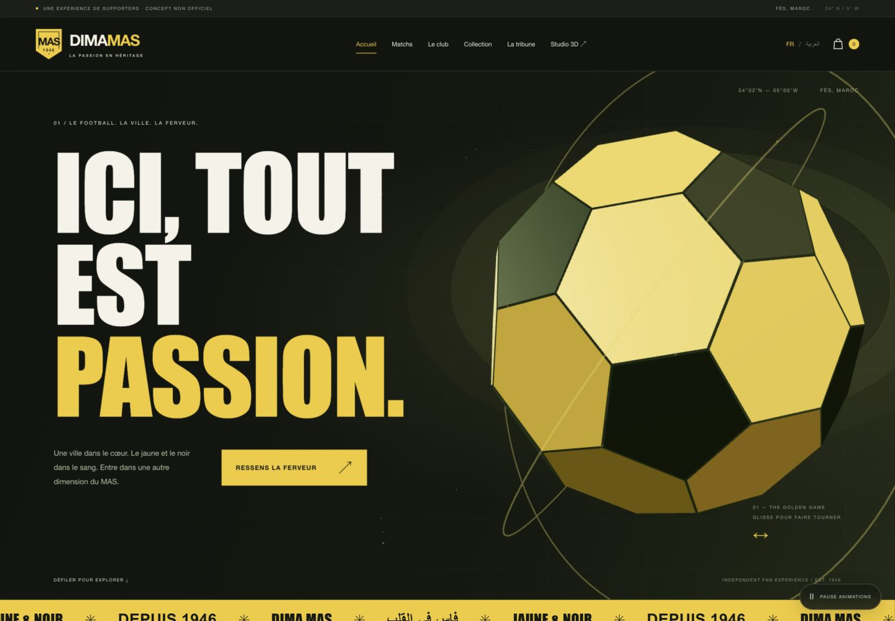

# DIMA MAS / V2

**One club. A whole world.** A six-page independent football fan experience inspired by Maghreb Association Sportive de Fès, built with native JavaScript and Three.js.



This is a portfolio concept, not an official club website or store. The emblem, jerseys, stadium model, trophy sculpture, and posters are original concept artwork. Match schedules, results, prices, and size information are illustrative. There are no real payments, orders, accounts, or public supporter posts.

## Run locally

Requires Node.js 22+. All browser dependencies are already vendored.

```sh
npm run dev
```

Open `http://127.0.0.1:4174`. To restore the pinned dependency and regenerate the vendor bundle, run `npm ci` and `npm run prepare:vendor`.

## Six pages

| Route | Experience |
| --- | --- |
| `index.html` | Rotating 3D football, orbit rings and particles; stadium with day, night and wireframe modes; Fès editorial and animated jersey spotlight |
| `matchs.html` | Demo fixture/result filters, opponent search, home/away selection and detail dialogs; editable 4–3–3, 4–4–2 and 3–5–2 tactical board |
| `club.html` | Fès visual story, interactive historical timeline, rotating gold trophy sculpture and linked historical references |
| `collection.html` | Two 3D kit previews, design details, FAQ and links carrying the chosen kit into the studio |
| `studio.html` | Personalized 3D jersey, lighting themes, automatic rotation, front/back views, keyboard/drag rotation, PNG export, demo cart and checkout |
| `tribune.html` | Waving 3D flags with wind controls, local supporter wall, two downloadable 1440 × 1920 posters and editorial stories |

French and Arabic content, RTL layouts, responsive navigation, scroll entrances, hover tilt, page transitions, motion pause, and preference persistence connect the experience.

## Engineering

- Original procedural geometry: a football with 12 pentagons and 20 hexagons, a stadium with instanced seats, a lathed trophy and animated cloth flags.
- Lazy Three.js imports and viewport-gated rendering. Scenes pause outside the viewport and in hidden tabs; pixel ratio is capped.
- A procedural jersey with front/back canvas textures, fabric relief, Unicode personalization and Arabic/Persian digit normalization.
- Normalized cart data, derived pricing, distinct configurations, quantity limits and one printing surcharge per shirt. Persisted IDs/prices are never trusted.
- Local storage for the cart, language/motion preference, lineup and supporter wall. User text is inserted as text, not HTML.
- Native dialogs, real HTML routes, browser history and modifier-click behavior, keyboard focus, reduced-motion support and 3D fallbacks.
- No CDN, build framework, API key or external service is needed at runtime.

```text
dist/
  *.html                Six semantic pages
  styles.css            Shared UI, cart, studio and RTL foundation
  universe.css          V2 page layouts and motion
  app.js                Cart, fixtures, dialogs, studio controls
  universe.js           Page interactions and local supporter tools
  experience.js         Football, stadium, trophy and cloth scenes
  jersey.js             Jersey renderer, textures and PNG export
  store.js              Pure cart, pricing and validation functions
  i18n.js               Shared French/Arabic UI translations
  assets/               Generated stadium and Fès imagery
  vendor/               Pinned Three.js runtime and MIT license
scripts/                Local server, vendoring and page validation
tests/                  Cart/validation domain tests
docs/                   Screenshots, QA, asset prompts and references
```

## Verify

```sh
npm test
npm run check
```

Six domain tests cover Unicode names, Arabic/Persian digits, pricing, configuration merging, quantity changes, totals, malformed storage and tampered data. The check command validates six authored JavaScript modules and checks all pages for primary headings, duplicate IDs and broken local references. Browser checks and limits are recorded in [QA.md](docs/QA.md).

## Deployment

This repository includes `vercel.json` for a static Vercel deployment. The build runs the syntax/page checks and domain tests, then publishes `dist/`. All browser dependencies are already vendored, so no package installation is needed for deployment.

Connect this repository to Vercel and use the **Other** framework preset. The committed configuration supplies the build command and output directory. Production deployments follow the `main` branch once the Git integration is connected.

For a local CLI deployment:

```sh
vercel --prod
```

No environment variables or API keys are required. The site can also be hosted by any static server serving `dist/`.

## Portfolio case study

**Problem:** Express the scale and emotion of football while giving visitors things to explore and create.

**Approach:** Six connected destinations with different visual rhythms. Make 3D functional: change stadium lighting, direct a lineup, change flag movement, customize a kit and export artwork.

**Tradeoffs:** Models are stylized procedural artwork. The stadium is imaginary and the trophy is not an official replica. The storefront and wall are local demos. Mobile checks use viewport emulation rather than physical devices.

**Next integrations:** Licensed imagery, verified fixtures, an authorized Shopify catalog, and server-validated pricing/checkout could replace demo content in a future production version.

## Credits

Three.js 0.170.0 is MIT-licensed; its notice is in `dist/vendor/THREE-LICENSE.txt`. Images were created with built-in image generation. [ASSETS.md](docs/ASSETS.md) contains exact prompts, artwork provenance and historical sources. No official club affiliation is claimed.
